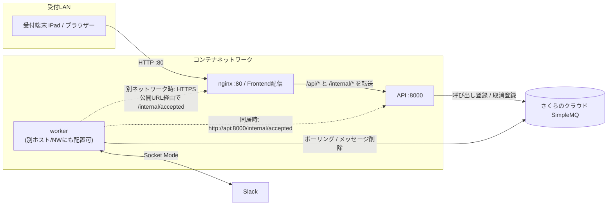

# yobiring

呼び出しアプリ。
呼び鈴 + *ring a bell* => yobiring。

iPad のアクセスガイド等でキオスク表示して使う想定。
さくらのクラウドのシンプルMQを用いたミニマル実装。

フロントエンドと API のネットワークを分離できるように MQ を介して通信する。

## 構成概要



## Usage

### 環境変数の設定

```sh
cat <<EOF >> ./worker/.env
SIMPLE_MQ_API_KEY=
SIMPLE_MQ_QUEUE=yobiring
SLACK_APP_TOKEN=xapp-
SLACK_BOT_TOKEN=xoxb-
SLACK_CHANNEL_ID=
EOF

cat <<EOF >> ./reception/api/.env
SIMPLE_MQ_API_KEY=
SIMPLE_MQ_QUEUE=yobiring
```

Slack App では Socket Mode の有効化が必要です。
OAuth & Permissions には少なくとも `"channels:history", "chat:write"` が必要です。

#### トークン認証を行う場合

```sh
TOKEN=$(python -c "import secrets; print(secrets.token_urlsafe(32))")
```

API と worker の両方に設定します。

```sh
echo RECEPTION_INTERNAL_TOKEN=$TOKEN >> worker/.env
echo RECEPTION_INTERNAL_TOKEN=$TOKEN >> reception/api/.env
```

### compose

#### 同居

```sh
docker compose up -d --build
```

#### 別居

フロント + API

```sh
docker compose up -d --build web api
```

worker

```sh
docker compose -f compose.worker.yaml up -d --build
```
